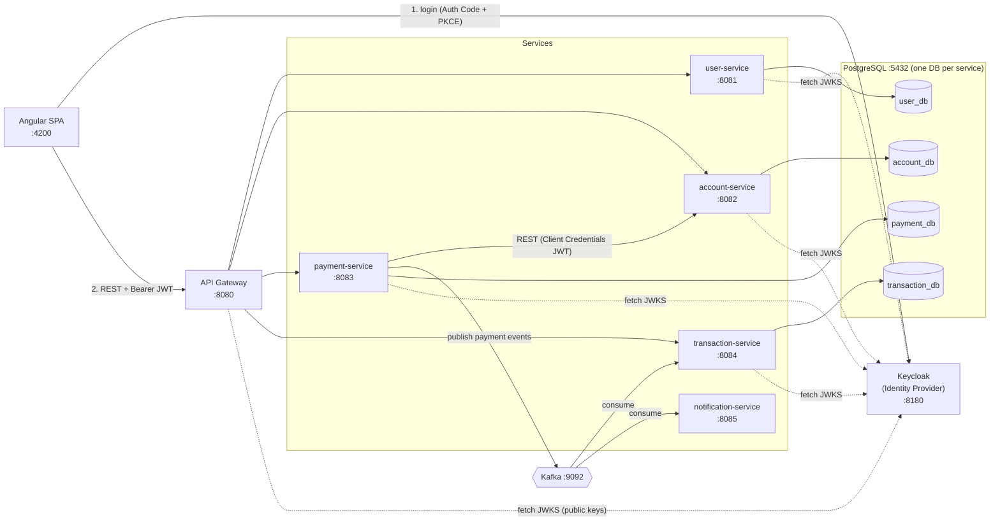
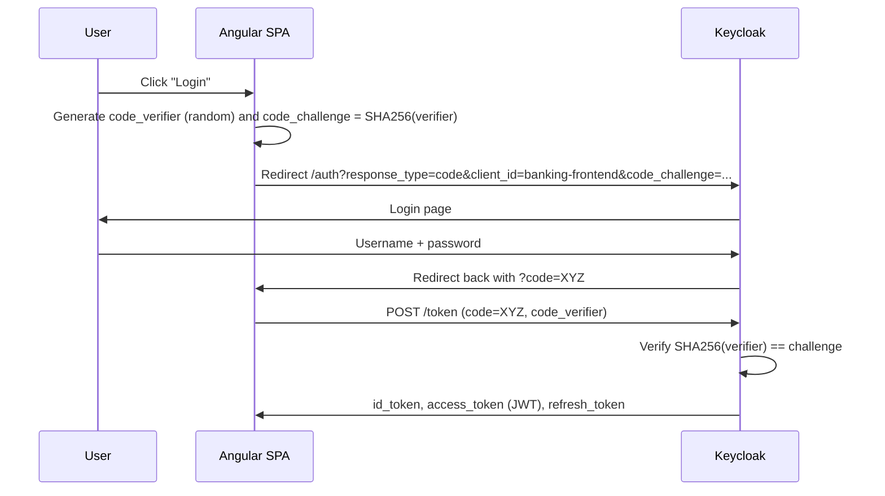
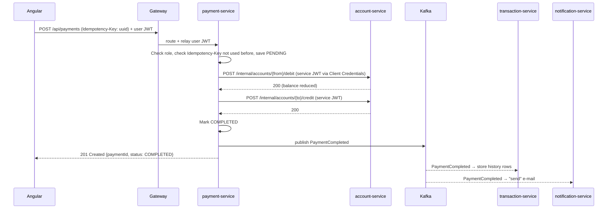

# Phase 1 — System Architecture

This document describes the target architecture of the Banking Platform. Later phases build it step by step and link back here.

---

## 1. Architectural concept

### Monolith vs microservices

A **monolith** is one deployable unit: one codebase, one process, usually one database. It is simple to build, test, and deploy. It gets harder as the team and domain grow: every change redeploys everything, one bad module can take down the whole app, and the shared database couples every feature to every other.

A **microservices architecture** splits the system into small services. Each service:

- owns one **business capability** (a *bounded context* in Domain-Driven Design terms);
- owns its **data**, and no other service reads its tables directly;
- is **deployed independently**;
- talks to other services only through **published contracts** (REST APIs, events).

What we gain: independent deployment, fault isolation, independent scaling, team autonomy.
What we pay: network calls that can fail, eventual consistency, distributed transactions, harder debugging, more infrastructure.

> Microservices are a trade-off, not an upgrade. Most of this project is about handling the costs (security across services, failures, consistency, observability).

### Bounded contexts in our bank

| Bounded context | Service | Owns (source of truth for) |
|---|---|---|
| Identity | **Keycloak** | Credentials, login sessions, roles |
| Customer | **user-service** | Customer profile (name, address, phone), link to the Keycloak user ID |
| Accounts | **account-service** | Accounts and **balances** |
| Payments | **payment-service** | Transfer requests, their state, and idempotency keys |
| History | **transaction-service** | Read-optimized transaction history (built from events) |
| Notifications | **notification-service** | Notification log (simulated e-mails) |

Note that the **balance belongs only to account-service**. payment-service never updates a balance itself; it asks account-service to do so. This rule is the heart of the database-per-service pattern.

---

## 2. Why each component exists

| Component | Why we need it | Trade-off / cost |
|---|---|---|
| **API Gateway** (Spring Cloud Gateway) | One entry point for the browser: routing, CORS, first JWT check, rate limiting. The frontend doesn't need to know where each service lives. | Extra network hop; can become a bottleneck or single point of failure if not replicated. |
| **Keycloak** | Login, passwords, MFA, SSO, and token issuing are security-critical and hard to get right. Using a certified OIDC provider is safer than writing our own. | One more stateful system to run; services depend on its availability for public keys (JWKS), though keys are cached. |
| **user-service** | Holds business data *about* a customer that Keycloak shouldn't hold (address, KYC status, and so on). | Two places to keep in sync (Keycloak user vs profile), linked by the `sub` claim. |
| **account-service** | Single owner of balances, so money is only changed in one place, under a database transaction. | Hot path: every payment depends on it. Needs resilience. |
| **payment-service** | Coordinates a transfer (debit A, credit B). Handles idempotency and compensation (Saga). | Most complex service; deals with partial failures. |
| **transaction-service** | Gives history queries their own read model, so they don't load account-service (a CQRS-style read side). | Data is **eventually consistent**: it can lag behind by milliseconds or seconds. |
| **notification-service** | Shows asynchronous, decoupled processing: payments still succeed when e-mail is down. | Duplicate or late messages must be tolerated. |
| **PostgreSQL** | Reliable ACID storage. One logical database per service. | In local dev we run one Postgres *server* with several databases, which is cheaper than one server per service. |
| **Kafka** | Durable event log. Publishers don't need to know their consumers, and consumers can replay. | Operational complexity; at-least-once delivery means consumers must be idempotent. |
| **Resilience4j** | Timeouts, retries, and circuit breakers on synchronous calls. | Wrongly tuned retries can amplify load (a "retry storm"). |
| **Prometheus / Grafana / OpenTelemetry** | Without metrics and traces you can't see *where* a request failed across 5 services. | More containers; tracing has a cost, so we sample. |

### Deliberately **not** included (and why)

- **Eureka / Consul (discovery server)**: in Docker Compose, the container name *is* the DNS name; in Kubernetes, `Service` objects give stable DNS and load balancing. A discovery server would duplicate what the platform already does. (We'll explain when it *is* appropriate in Phase 6.)
- **Spring Cloud Config Server**: environment variables, plus Kubernetes ConfigMaps and Secrets later, are enough at this size.
- **Two-phase commit (XA)**: it doesn't scale across services and Kafka doesn't support it with Postgres. We use a **Saga** instead (Phase 13).

---

## 3. Architecture diagram



ASCII version:

```
                         ┌──────────────────────┐
     (1) login/PKCE      │   Keycloak :8180     │
  ┌─────────────────────►│  realm: banking      │◄─── JWKS (public keys) fetched
  │                      └──────────────────────┘     by gateway + every service
  │
┌─┴──────────┐  (2) Bearer JWT   ┌────────────────┐
│ Angular    ├──────────────────►│ API Gateway    │  CORS · JWT check · rate limit · routing
│ SPA :4200  │                   │ :8080          │
└────────────┘                   └──┬───┬───┬───┬─┘
                                    │   │   │   │
                   ┌────────────────┘   │   │   └───────────────────┐
                   ▼                    ▼   ▼                       ▼
           ┌──────────────┐ ┌──────────────┐ ┌──────────────┐ ┌──────────────────┐
           │ user-service │ │account-svc   │◄┤payment-svc   │ │transaction-svc   │
           │ :8081        │ │ :8082        │ │ :8083        │ │ :8084            │
           └──────┬───────┘ └──────┬───────┘ └──┬────────┬──┘ └────────▲─────────┘
                  │                │   REST +   │        │ publish     │ consume
                  ▼                ▼   client-  ▼        ▼             │
              user_db         account_db  creds payment_db   ┌─────────┴────────┐
                                          JWT                │  Kafka :9092     ├──► notification-svc :8085
                                                             └──────────────────┘
```

---

## 4. Request flows

### Flow A: Login (Authorization Code + PKCE), implemented in Phases 4 and 7



**Why PKCE?** A browser app can't keep a client secret. PKCE proves that the app redeeming the `code` is the same app that started the login, so a stolen authorization code is useless.

### Flow B: "Show my accounts" (synchronous read), Phases 5, 6 and 8

1. Angular → `GET http://localhost:8080/api/accounts` with `Authorization: Bearer <access_token>`.
2. **Gateway** checks the JWT signature (using Keycloak's public keys), expiry, and issuer. If invalid → `401`. If too many requests → `429`.
3. Gateway routes `/api/accounts/**` → `account-service:8082`, **forwarding the same token** (token relay).
4. **account-service validates the JWT again** (zero trust: never assume the caller is the gateway) and checks the role `CUSTOMER`.
5. It loads only accounts whose `ownerId == jwt.sub`. This is the **ownership** check, which roles alone can't express.
6. Response `200 OK` with a list of account DTOs travels back through the gateway.

### Flow C: Transfer money (sync + async), Phases 9 to 13



If the **credit** fails after the **debit** succeeded, payment-service runs a **compensating action** (credit the money back to the source) and publishes `PaymentFailed`. That's the Saga pattern (Phase 13).

---

## 5. Communication matrix

| From → To | Style | Auth used | Why this style |
|---|---|---|---|
| Angular → Keycloak | Browser redirect (OIDC) | User credentials | Standard login |
| Angular → Gateway | REST/JSON | **User** access token | User needs an immediate answer |
| Gateway → services | HTTP proxy | **User** token relayed | Services enforce their own authorization |
| payment → account | REST (WebClient/OpenFeign) | **Service** token (Client Credentials) | Payment needs to know *now* whether the debit succeeded |
| payment → Kafka → transaction, notification | Async events | Kafka network access (SASL/ACLs in production) | History and e-mail don't need to block the user; decoupled |

---

## 6. Ports and names (local development)

| Component | Port | Hostname inside Docker/K8s |
|---|---|---|
| Angular dev server | 4200 | — |
| API Gateway | 8080 | `api-gateway` |
| user-service | 8081 | `user-service` |
| account-service | 8082 | `account-service` |
| payment-service | 8083 | `payment-service` |
| transaction-service | 8084 | `transaction-service` |
| notification-service | 8085 | `notification-service` |
| Keycloak | 8180 | `keycloak` |
| PostgreSQL | 5432 | `postgres` |
| Kafka | 9092 | `kafka` |
| Prometheus | 9090 | `prometheus` |
| Grafana | 3000 | `grafana` |

---

## 7. Roles (RBAC model), implemented in Phase 8

| Capability | CUSTOMER | SUPPORT | ADMIN |
|---|---|---|---|
| View **own** profile, accounts, transactions | ✅ | — | — |
| Transfer money from **own** accounts | ✅ | ❌ | ❌ |
| View **any** customer's profile/accounts | ❌ | ✅ (read-only) | ✅ |
| Create/close accounts, manage users | ❌ | ❌ | ✅ |

Service clients (machine identities) get **scopes** instead, for example `payment-service` gets `accounts:write` for `/internal/**` only (least privilege).

---

## 8. Versions and constraints

| Technology | Version | Constraint / note |
|---|---|---|
| Java | **21** (bytecode target) | Spring Boot 3.x requires Java 17+. We target 21 for virtual threads, records, and pattern matching. Building on JDK 25 is fine: `--release 21` is used. |
| Spring Boot | **3.5.16** | Last 3.x line. **Open-source support for 3.5 ended mid-2026**; Spring Boot 4.x is current. We use 3.5 because the course specifies 3.x, and almost all concepts transfer to 4.x. |
| Spring Cloud | **2025.0.3** ("Northfields") | Release train for Boot 3.5. Boot 4.x needs 2025.1.x. Mismatched trains fail at startup with a compatibility error. |
| Spring Cloud Gateway | from the 2025.0 train | Starter was renamed to `spring-cloud-starter-gateway-server-webflux` (the old name is deprecated). Reactive (Netty), **not** servlet. |
| Keycloak | 26.x | Quarkus-based distribution; admin URL has no `/auth` prefix. |
| PostgreSQL | 17 | |
| Kafka | 3.9+/4.x in **KRaft** mode | No ZooKeeper needed. |
| Angular | 18+ (latest LTS when we reach Phase 7) | We'll use a certified OIDC client library (`angular-auth-oidc-client`) rather than writing PKCE by hand. |

**Rule:** never set Spring library versions by hand in a service POM. Let the Boot parent and the Cloud BOM in the root `pom.xml` choose them, so they stay compatible.

---

## 9. Key design decisions

1. **Monorepo + Maven aggregator.** Easy for learning: one checkout, one build. Each service is still a separate Spring Boot app with its own Dockerfile and deploy. *Trade-off:* in large companies polyrepos give stronger team boundaries.
2. **No shared domain library.** Sharing entities and DTOs between services couples their release cycles (the "distributed monolith" anti-pattern). Contracts are duplicated on purpose, or later generated from OpenAPI or event schemas.
3. **Defense in depth for JWT.** Both the gateway *and* each service validate tokens. If someone reaches a service directly (inside the network), it's still protected.
4. **Authorization lives in the backend.** Angular route guards are UX only; they can be bypassed with curl.
5. **Balances change only in account-service, inside a local DB transaction**, with optimistic locking to prevent lost updates.
6. **Idempotency keys** on `POST /payments`, so retries (by the user, browser, or Resilience4j) never transfer money twice.
7. **Events are published after the DB commit** (Transactional Outbox in Phase 13), so we never announce a payment that was rolled back.
8. **Platform DNS for discovery** (Docker Compose and then Kubernetes), not Eureka.

---

## 10. Interview questions (Phase 1)

1. What is a bounded context, and how did you decide service boundaries here?
2. Why must each microservice own its database? What breaks if two services share tables?
3. What is a "distributed monolith", and how do you avoid one?
4. When would you **not** choose microservices?
5. Why use an API Gateway? What responsibilities should it *not* take on (hint: business logic)?
6. Why validate the JWT in each service if the gateway already did?
7. Synchronous REST vs asynchronous events: how do you decide per interaction?
8. Why can't we use a single ACID transaction across payment-service and account-service? What do we use instead?
9. Why is Spring Cloud Gateway reactive, and what does that mean for code written inside it?
10. What is the risk of mismatched Spring Boot and Spring Cloud versions?
