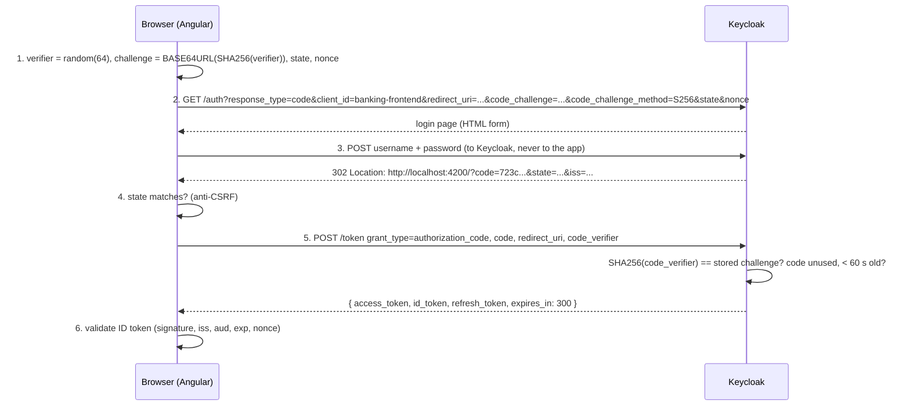

# Phase 4 — Keycloak and Centralized Authentication

## 1. Concepts

### Authentication vs authorization
- **Authentication:** *who are you?* (login: password, MFA). Done **once**, by Keycloak.
- **Authorization:** *what may you do?* (roles, ownership). Done by **every service** on every request (Phases 5 and 8).

### Centralized login and SSO
No service handles passwords. All of them trust one **Identity Provider (IdP)**. After one login, Keycloak keeps an **SSO session** (a cookie on Keycloak's own domain). Any other app in the realm that redirects to Keycloak is logged in immediately, with no password prompt. That's Single Sign-On.

### OAuth 2.0 vs OpenID Connect vs JWT

| | What it is | Answers | Produces |
|---|---|---|---|
| **OAuth 2.0** | *Authorization* framework (RFC 6749) | "May this client call this API on the user's behalf?" | **Access token** |
| **OpenID Connect** | *Identity* layer **on top of** OAuth 2.0 | "Who is the user who just logged in?" | **ID token** (+ `/userinfo`, discovery, logout) |
| **JWT** | A token **format** (RFC 7519): `header.payload.signature`, base64url | — (only a container) | — |

OAuth doesn't say tokens must be JWTs, and JWTs are used outside OAuth. Keycloak happens to issue both tokens as signed JWTs.

### The three tokens

| Token | Audience | Purpose | Lifetime here |
|---|---|---|---|
| **ID token** | the client (`aud=banking-frontend`) | Tells the **app** who logged in. **Never** send it to an API. | 5 min |
| **Access token** | the APIs (`aud=banking-api`) | Sent as `Authorization: Bearer …` on every API call. | **5 min** |
| **Refresh token** | Keycloak only | Gets new tokens without asking for the password again. **Rotated** on every use. | 30 min idle / 10 h max |

Short access tokens matter because **a JWT can't be revoked**: APIs validate it offline with the public key, so a stolen token works until `exp`. We proved this: after logout, the refresh token died immediately, but the access token's signature stays valid until it expires.

## 2. Why Keycloak (and not our own login)

Password hashing, brute-force protection, MFA, account lockout, session management, key rotation, OIDC compliance, social login, admin UI: each is easy to get subtly wrong. Keycloak is a certified OpenID Provider. **Trade-off:** one more stateful system that must be highly available. If it's down, nobody can *log in*, but already-issued tokens keep working until they expire, because services only need the cached public keys.

## 3. Architecture

```
                         ┌──────────────── Keycloak :8180 ─────────────────┐
                         │ realm "banking"                                  │
   Browser / Angular ───►│  clients:  banking-frontend  (public, PKCE S256) │
   (Phase 7)             │            payment-service   (confidential,      │
                         │                              client credentials) │
                         │  roles:    CUSTOMER  SUPPORT  ADMIN              │
                         │  users:    alice bob (CUSTOMER) sam (SUPPORT)    │
                         │            ada (ADMIN)                           │
                         │  keys:     RS256 signing key → /certs (JWKS)     │
                         └──────────────┬───────────────────────────────────┘
                                        │ JDBC (role keycloak_svc)
                                        ▼
                         banking-postgres :5433 → keycloak_db
```

**Why there's no client for the API Gateway:** in our design the gateway is a *resource server*. It only **validates** tokens with the public keys and never requests tokens itself. Clients exist for things that *obtain* tokens: the SPA, which logs users in, and payment-service, which logs **itself** in. Don't create infrastructure you don't need.

## 4. Request flow: Authorization Code + PKCE (run it yourself)

```bash
./infrastructure/keycloak/pkce-login.sh alice
```



Real output (step 3 and step 6, shortened):

```
302 Location: http://localhost:4200/?state=wsyIcbOWcmoB5E6kTVYokw&session_state=X_b-...&iss=http%3A%2F%2Flo...&code=723c0c7e-aca4-...

token_type=Bearer  expires_in=300s  refresh_expires_in=1800s  scope=openid email profile

ID token (for the CLIENT, proves authentication):
  iss                  http://localhost:8180/realms/banking
  aud                  banking-frontend
  sub                  7f3c9a2e-1b4d-4e8a-9c6f-2d5b8e1a0f3c
  preferred_username   alice
  nonce                TAP4R8OKHOHn443Tspu96g

Access token (for the API, carries authorization):
  header  alg=RS256 kid=T9oBjogjlaAGwu1D33xUBOpNgNSolnPEdkA4fwRGiyg
  iss                  http://localhost:8180/realms/banking
  aud                  ['banking-api', 'account']
  sub                  7f3c9a2e-1b4d-4e8a-9c6f-2d5b8e1a0f3c
  azp                  banking-frontend
  realm_access.roles   ['default-roles-banking', 'offline_access', 'CUSTOMER', 'uma_authorization']
  exp - iat            300s
```

### What each claim is for (what Phase 5 will check)

| Claim | Meaning | Checked by services? |
|---|---|---|
| `iss` | Who issued it. Must be exactly our realm URL. | ✅ rejects tokens from other realms/IdPs |
| signature + `kid` | Signed with Keycloak's private key. `kid` selects the public key from JWKS. | ✅ rejects forged/modified tokens |
| `exp`, `iat`, `nbf` | Validity window | ✅ rejects expired tokens |
| `aud` | Intended recipient. Our audience mapper adds `banking-api`. | ✅ rejects tokens meant for another API |
| `sub` | Stable user ID, **= `ownerId` / `keycloakUserId`** in our databases | used for ownership checks |
| `azp` | Which client obtained the token | useful for logs/policies |
| `realm_access.roles` | Realm roles | mapped to Spring `ROLE_*` in Phase 5 |

The extra `account` audience comes from Keycloak's built-in account-console roles (`default-roles-banking`). It's harmless; we validate that `banking-api` is *present*.

### Why PKCE (we tried the attacks)

| Attack | Result |
|---|---|
| Start a login **without** `code_challenge` | `error=invalid_request&error_description=Missing parameter: code_challenge_method` |
| Steal the `code` (e.g. from browser history, a malicious app on a custom URL scheme) and redeem it **without the right verifier** | `{"error":"invalid_grant","error_description":"PKCE verification failed: Code mismatch"}` |
| Use the password grant (app collects the password itself) | `{"error":"unauthorized_client","error_description":"Client not allowed for direct access grants"}` |

The challenge travels through the browser (it can be seen). The verifier is only sent in the direct POST to `/token`. Knowing the challenge doesn't reveal the verifier, because SHA-256 is one-way.

## 5. Project structure (added)

```
banking-platform/
├── docker-compose.yml                         + keycloak service
├── .env.example                               + KEYCLOAK_DB_PASSWORD, DEMO_USER_PASSWORD
├── infrastructure/
│   ├── keycloak/
│   │   ├── realm/banking-realm.json           realm as code (imported at startup)
│   │   └── pkce-login.sh                      curl walkthrough of Auth Code + PKCE
│   └── postgres/init/02-create-keycloak-database.sh
└── documentation/
    ├── 04-keycloak-centralized-authentication.md
    └── http/phase-04.http
```

No Java changes in this phase. The services learn to validate these tokens in Phase 5.

## 6. Important configuration

### Realm (`banking-realm.json`)

| Setting | Value | Why |
|---|---|---|
| `sslRequired` | `external` | HTTP allowed from localhost/private IPs only. Production: `all` + TLS. |
| `registrationAllowed` | `false` | Banks onboard customers through KYC, not self-signup. |
| `passwordPolicy` | `length(12) and notUsername and notEmail` | Basic hygiene. |
| `bruteForceProtected` | 5 failures → growing wait (max 15 min) | Slows down password guessing. |
| `accessTokenLifespan` | 300 s | Limits the damage of a leaked token (no revocation for JWTs). |
| `ssoSessionIdleTimeout` / `MaxLifespan` | 30 min / 10 h | Banking-style session limits. |
| `revokeRefreshToken` + `refreshTokenMaxReuse: 0` | rotation | A stolen refresh token used after the real one gives `Maximum allowed refresh token reuse exceeded`. |
| user `id`s fixed | e.g. alice = `7f3c9a2e-…` | Stable `sub` values, so profiles and accounts can be linked in demos. |
| `${PAYMENT_SERVICE_CLIENT_SECRET}`, `${DEMO_USER_PASSWORD}` | placeholders | Keycloak replaces them with environment variables at import. **No secrets in git.** |

### Clients

| | `banking-frontend` | `payment-service` |
|---|---|---|
| Type | **public** (code runs in a browser, anyone can read it) | **confidential** (server-side, can keep a secret) |
| Flow | Authorization Code + **PKCE S256 required** | **Client Credentials** (service account) |
| Disabled | implicit, password grant, service account | browser login, password grant |
| `redirectUris` | `http://localhost:4200/*` (dev; production uses **exact** URIs) | — |
| `webOrigins` | `http://localhost:4200` (CORS for the token endpoint) | — |
| Audience mapper | adds `banking-api` to `aud` | adds `banking-api` to `aud` |

### Docker Compose

| Setting | Why |
|---|---|
| `start-dev --import-realm` | Dev mode (HTTP, no build step) + import the realm JSON. **Existing realms are skipped** (`Strategy: IGNORE_EXISTING`). |
| `KC_DB=postgres` → `keycloak_db` | Keycloak is a stateful service, so it gets its own DB and role like everyone else. |
| `KC_HOSTNAME=http://localhost:8180` | Fixes `iss`. In Phase 15 the services run in Docker and reach Keycloak as `keycloak:8180`, but tokens must still say `localhost:8180`, otherwise issuer validation fails. |
| `KC_BOOTSTRAP_ADMIN_*` | Keycloak 26 replacement for the old `KEYCLOAK_ADMIN` variables. |
| healthcheck on `:9000/health/ready` | The image has no curl, so we use bash `/dev/tcp`. |
| `depends_on: postgres: service_healthy` | Start only when the DB accepts connections. |

## 7. User authentication vs service authentication

| | User (Authorization Code + PKCE) | Service (Client Credentials) |
|---|---|---|
| Who is authenticated | a human | a program (payment-service) |
| Proof | password (+MFA) typed into **Keycloak** | `client_id` + `client_secret` (or a private-key JWT / mTLS) |
| `sub` | the user (`7f3c…` = alice) | the client's service account (`service-account-payment-service`) |
| Refresh token | yes | no; just request a new token |
| Used for | "Alice views **her** accounts" | "payment-service debits an account **as part of a transfer**" |

Real Client Credentials output:

```
POST /token  grant_type=client_credentials  (HTTP Basic: payment-service:<secret>)
keys: access_token, expires_in, not-before-policy, refresh_expires_in, scope, token_type   ← no refresh_token
  sub                  2b5bcd1a-793b-478a-bb23-ba4f237cb143
  azp                  payment-service
  aud                  ['banking-api', 'account']
  preferred_username   service-account-payment-service
```

The service account has **no business permissions yet**. Phase 10 grants it exactly one permission (debit/credit through internal endpoints): least privilege.

## 8. Commands

```bash
cd banking-platform
docker compose up -d                 # postgres + keycloak
docker compose ps                    # both "(healthy)" (Keycloak takes ~20 s)
docker compose logs keycloak | grep -E "imported|started in"
```

- Admin console: <http://localhost:8180/admin>, user `admin`, password `KEYCLOAK_ADMIN_PASSWORD` from `.env`. Switch to realm **banking** (top-left).
- Account console for a user: <http://localhost:8180/realms/banking/account>, log in as `alice` with `DEMO_USER_PASSWORD` from `.env`.
- Login walkthrough: `./infrastructure/keycloak/pkce-login.sh alice` (also `bob`, `sam`, `ada`).
- Use a token later: `TOKEN=$(./infrastructure/keycloak/pkce-login.sh alice 2>/dev/null)`.

### Re-import after editing the realm JSON

```bash
# Option A: delete the realm in the admin console (Realm settings → Action → Delete), then
docker compose restart keycloak
# Option B: reset all Keycloak data (users created in the UI are lost)
docker compose stop keycloak
docker exec banking-postgres psql -U postgres -c 'DROP DATABASE keycloak_db' \
  -c 'CREATE DATABASE keycloak_db OWNER keycloak_svc'
docker compose up -d keycloak
```

### Existing Postgres volume from Phase 3

The `keycloak_db` init script only runs automatically on a fresh volume. If your volume was created in Phase 3:

```bash
docker compose up -d postgres
docker exec banking-postgres bash /docker-entrypoint-initdb.d/02-create-keycloak-database.sh
```

## 9. curl examples

```bash
set -a; . ./.env; set +a
OIDC=http://localhost:8180/realms/banking/protocol/openid-connect
TF=${TMPDIR:-/tmp}/banking-alice-tokens.json         # written by pkce-login.sh
RT=$(python3 -c "import json; print(json.load(open('$TF'))['refresh_token'])")

# Discovery: every endpoint and capability of the IdP
curl -s http://localhost:8180/realms/banking/.well-known/openid-configuration | python3 -m json.tool | head -20

# JWKS: public keys. The access token header's "kid" picks one of these.
curl -s $OIDC/certs
#   kid=T9oB...  kty=RSA alg=RS256    use=sig   ← verifies token signatures
#   kid=E3Qq...  kty=RSA alg=RSA-OAEP use=enc

# UserInfo
curl -s $OIDC/userinfo -H "Authorization: Bearer $TOKEN"
# {"sub":"b0b5e1c2-...","email_verified":true,"name":"Bob Customer","preferred_username":"bob",...}

# Refresh (rotation: the response contains a NEW refresh token; the old one is now dead)
curl -s -X POST $OIDC/token -d grant_type=refresh_token -d client_id=banking-frontend \
     --data-urlencode "refresh_token=$RT"
# Using the old one again:
# {"error":"invalid_grant","error_description":"Maximum allowed refresh token reuse exceeded"}

# Logout: ends the SSO session
curl -s -w '%{http_code}\n' -X POST $OIDC/logout -d client_id=banking-frontend \
     --data-urlencode "refresh_token=<current refresh token>"
# 204, then refresh gives {"error":"invalid_grant","error_description":"Session not active"}

# Client Credentials
curl -s -X POST $OIDC/token -d grant_type=client_credentials \
     -u "payment-service:$PAYMENT_SERVICE_CLIENT_SECRET"
```

In the browser (Phase 7), logout is a redirect to the `end_session_endpoint`:
`GET /realms/banking/protocol/openid-connect/logout?client_id=banking-frontend&id_token_hint=<id_token>&post_logout_redirect_uri=http://localhost:4200/`.
This clears the Keycloak SSO cookie, so every app in the realm is logged out (Single Logout).

To decode a token by hand: paste it into <https://jwt.io> (fine for local demo tokens, **never** for real ones), or:
```bash
echo "$TOKEN" | cut -d. -f2 | tr '_-' '/+' | base64 -d 2>/dev/null | python3 -m json.tool
```

## 10. Common errors and troubleshooting

| Symptom | Cause / fix |
|---|---|
| Keycloak restarts, log shows `password authentication failed for user "keycloak_svc"` | `keycloak_db`/role missing or password changed. Run the 02 init script (section 8). |
| Edited `banking-realm.json`, nothing changed | Import skips existing realms. Re-import (section 8). |
| Login page: `Invalid parameter: redirect_uri` | The redirect URI isn't in the client's `redirectUris` (check trailing slash, port, http vs https). |
| `Missing parameter: code_challenge_method` | The client requires PKCE and the app didn't send it. |
| `PKCE verification failed` | Verifier doesn't match the challenge (wrong storage or encoding). Must be base64**url** without `=`. |
| `Code not valid` | Codes are single-use and expire after about a minute. Restart the flow. |
| `Invalid client or Invalid client credentials` | Wrong `client_secret`. The secret comes from `.env` and is only applied at **first import**. |
| `Session not active` | User logged out or the SSO session timed out. Log in again. |
| Login fails after a few wrong passwords even with the right one | Brute-force protection. Wait, or unlock in admin console → Users → alice. |
| Later: services reject tokens with `iss` mismatch | Token was obtained via a different hostname. Always use `localhost:8180` (fixed by `KC_HOSTNAME`). |
| `pkce-login.sh`: `no login form returned` | Keycloak not ready yet (`docker compose ps`) or realm not imported. |
| `docker pull` fails with `short read / unexpected EOF` | Network drop. Retry; finished layers are cached. |

## 11. Production notes (what we simplified)

- `start` (not `start-dev`) with TLS, `KC_HOSTNAME=https://auth.bank.com`, and an optimized image built with `kc.sh build`.
- At least 2 Keycloak replicas (clustered caches), and a managed Postgres.
- Confidential service clients use **private-key JWT** or **mTLS** client authentication instead of shared secrets.
- Exact redirect URIs, no wildcards. MFA (OTP/WebAuthn) required for ADMIN and SUPPORT.
- Realm config managed as code (e.g. `keycloak-config-cli` or Terraform), not by clicking.

## 12. Interview questions

1. What is the difference between OAuth 2.0, OpenID Connect and JWT?
2. ID token vs access token: who is each for, and why must an API never accept an ID token?
3. Walk through Authorization Code + PKCE. What does PKCE protect against?
4. Why are the implicit flow and the password grant deprecated (OAuth 2.1)?
5. Public vs confidential clients: why can't a SPA use a client secret?
6. What are `state` and `nonce` for?
7. A JWT is stolen. What can the attacker do and for how long? How do short lifetimes and refresh-token rotation help?
8. How does an API verify a JWT without calling Keycloak? What is JWKS, and what is `kid` for?
9. Why validate `iss` and `aud`?
10. How does SSO work technically? How does Single Logout work?
11. User authentication vs service authentication (Client Credentials): differences in `sub`, refresh tokens, and permissions.
12. Keycloak is down: what still works and what doesn't?
13. Where would you store tokens in a browser SPA, and what are the XSS/CSRF trade-offs? (Phase 7 goes deeper, including the BFF pattern.)
