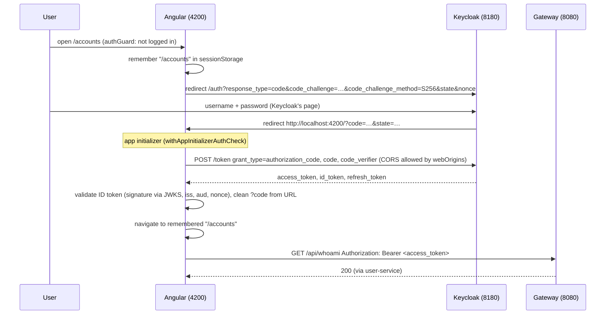

# Phase 7 — Angular: Login, Logout and Token Management

## 1. Concept: the browser app as an OIDC *public client*

The Angular app is a **public client**: its code is downloaded by every visitor, so it can't keep a secret. It still logs users in securely by:

1. sending the user to **Keycloak** to authenticate (the app never sees the password)
2. receiving a one-time **authorization code** on its redirect URI
3. exchanging the code **plus the PKCE verifier** for tokens
4. attaching the **access token** to API calls, but **only** calls to our gateway
5. **renewing** tokens before they expire, using the refresh token
6. **logging out** at Keycloak, which ends the SSO session for every app in the realm

We use **`angular-auth-oidc-client`**, an OpenID-certified library, instead of hand-writing PKCE, state/nonce checks, ID-token validation and refresh logic. Security protocol code is exactly the kind of code you shouldn't write yourself.

### What the frontend is (and isn't) responsible for

| Frontend does | Frontend does **not** |
|---|---|
| Start login/logout, hold tokens, attach them to API calls | Make security decisions. Anything in the browser can be changed by the user. |
| Adapt the UI to roles (hide the Admin menu, guard routes) | Enforce authorization. The gateway and services do that on every request (Phases 5, 6, 8). |
| Show friendly errors (401 → login again, 403 → "not allowed") | Validate tokens for trust. Decoding a JWT for display is fine; trusting it is not. |

## 2. Why we need each piece

| Piece | Why |
|---|---|
| OIDC library + `withAppInitializerAuthCheck()` | Handles the callback (`?code=…&state=…`) before the first route renders, so guards always see the real login state |
| **Auth interceptor** | Every API call needs `Authorization: Bearer …`. One place adds it, and only for the gateway origin. |
| **Error interceptor** | One consistent reaction to 401/403, plus problem+json → `ApiError` (with `requestId`) for the UI |
| **Route guards** | Don't show screens the user can't use (UX). Remember the requested page across the login redirect. |
| **Silent renew with refresh tokens** | Access tokens live 5 minutes. Users shouldn't be sent to the login page every 5 minutes. |
| **RP-initiated logout** | Deleting local tokens isn't logout: Keycloak's SSO cookie would log the user straight back in. |

## 3. Architecture

```
 Browser  http://localhost:4200
 ┌───────────────────────────────────────────────────────────────────────────────────────┐
 │ Angular 22 (zoneless, signals)                                                        │
 │                                                                                       │
 │  provideAuth(authConfig, withAppInitializerAuthCheck())   ◄── angular-auth-oidc-client │
 │     • discovery, PKCE, state/nonce, code exchange, ID-token validation                │
 │     • silent renew via refresh token (30 s before expiry)                             │
 │     • tokens in sessionStorage (per tab, cleared when the tab closes)                 │
 │                                                                                       │
 │  AuthService (facade)  ─ signals: isAuthenticated, username, roles, claims            │
 │  authGuard / roleGuard ─ UX only                                                      │
 │                                                                                       │
 │  HttpClient ─► authTokenInterceptor ─► apiErrorInterceptor ─► network                 │
 │                 (Bearer only for http://localhost:8080/…)                             │
 └──────────┬───────────────────────────────────────────────────────┬────────────────────┘
            │ redirects + token endpoint (CORS: webOrigins)          │ /api/** + Bearer (CORS: gateway)
            ▼                                                        ▼
     Keycloak :8180 (realm banking, client banking-frontend)   API Gateway :8080 ─► services
```

## 4. Request flows

### Login (verified in a real browser by the e2e tests)



What the e2e test asserts in this flow:
- the redirect contains `code_challenge_method=S256`
- the token request body contains `grant_type=authorization_code` **and** `code_verifier=`
- after login the URL no longer contains `code=`
- the user lands back on `/accounts` (the page originally requested)
- API calls to the gateway carry `Authorization: Bearer ey…`
- **no** request to Keycloak carries the bearer token
- a POST (CORS preflight + write) creates an account end to end

### Token renewal

5-minute access tokens. The library schedules a refresh 30 s before `exp`:
`POST /token grant_type=refresh_token&refresh_token=…` → new access, ID **and refresh** token (rotation: the old refresh token is now dead). The e2e test triggers this on the Token page and checks for the `refresh_token` grant on the wire.

### Logout

`AuthService.logout()` → `oidc.logoff()` → browser goes to
`/realms/banking/protocol/openid-connect/logout?id_token_hint=…&post_logout_redirect_uri=http://localhost:4200/`.
Keycloak ends the SSO session and redirects back, and the library deletes the local tokens. The e2e test proves this is a *real* logout: after logging out, opening `/accounts` shows Keycloak's **password form** again. With local-only logout (`logoffLocal()`), the SSO cookie would have logged the user straight back in.

## 5. Project structure

```
frontend/
├── package.json                 Angular 22.3, angular-auth-oidc-client 22.0.3, Vitest, Playwright
├── playwright.config.ts         e2e: installed Chrome, auto-starts ng serve
├── e2e/login.e2e.ts             6 real-browser tests (Keycloak + gateway + services)
└── src/
    ├── environments/environment.ts      apiUrl, Keycloak authority/clientId (public values)
    ├── styles.scss
    └── app/
        ├── app.config.ts                provideAuth, interceptors, router
        ├── app.routes.ts                lazy pages, guards
        ├── app.ts / app.html            shell: nav, user, roles, login/logout
        ├── auth/
        │   ├── auth.config.ts           OIDC settings (explained below)
        │   ├── auth.service.ts          facade with signals
        │   ├── auth.guards.ts           authGuard, roleGuard
        │   └── auth-token.interceptor.ts
        ├── core/
        │   ├── api.service.ts           typed calls to the gateway
        │   └── api-error.interceptor.ts 401 / 403 / ApiError
        ├── shared/error-message.ts      shows ApiError + requestId
        └── pages/  home · accounts · token (inspector) · admin · forbidden
```

## 6. Important code and configuration

### `auth.config.ts`

| Setting | Value | Why |
|---|---|---|
| `authority` | `http://localhost:8180/realms/banking` | The library reads `/.well-known/openid-configuration` and learns all endpoints |
| `responseType` | `code` | Authorization Code flow. PKCE is automatic for public clients. |
| `scope` | `openid profile email` | No `offline_access`: offline tokens survive logout and SSO session end, which is wrong for banking |
| `redirectUrl` / `postLogoutRedirectUri` | `http://localhost:4200/` | Must match the Keycloak client's registered URIs exactly |
| `silentRenew` + `useRefreshToken` | `true` | Renew in the background with the (rotating) refresh token. No hidden iframe needed. |
| `renewTimeBeforeTokenExpiresInSeconds` | 30 | Renew before the gateway would reject an expired token |
| `ignoreNonceAfterRefresh` | `true` | Keycloak doesn't repeat the nonce in refreshed ID tokens. The nonce protects the initial login. |
| `autoUserInfo` | `false` | ID token claims are enough; saves a request |

### Interceptor order

`withInterceptors([authTokenInterceptor, apiErrorInterceptor])`: the token is attached first, then the error handler sees the response. The **allow-list** in `isGatewayRequest()` is the security-relevant line. The unit test includes the trap URL `http://localhost:8080.evil.example/...`, which is why the check is `startsWith(apiUrl + '/')` and not `startsWith(apiUrl)`.

### Redirect-loop protection

If the backend rejected even fresh tokens (say, a broken audience mapper), "401 → log in again" would loop forever, because Keycloak's SSO session logs the user straight back in. `apiErrorInterceptor` redirects at most once per 30 s and otherwise shows the error. Covered by a unit test.

### Zoneless + signals

Angular 22 projects are **zoneless** by default: no `zone.js` patching browser APIs. The UI updates when **signals** change. `AuthService` exposes signals (`isAuthenticated`, `roles`, …) built with `toSignal()` from the library's observables, and pages store API results in signals.

## 7. Where should tokens live? (and when to use a BFF)

| Option | XSS (malicious script in the page) | CSRF | Complexity |
|---|---|---|---|
| **sessionStorage** (library default, used here) | Script can read the tokens | Not applicable (no cookies) | Low |
| localStorage | Same as above, **plus** survives tab close and is shared across tabs | n/a | Low |
| In-memory only | Harder to steal, but lost on page reload (forces a re-login or an iframe/cookie trick) | n/a | Medium |
| **BFF** (Backend-for-Frontend): tokens stay on a server; the browser gets an `HttpOnly`, `Secure`, `SameSite` session cookie | Script **can't** read tokens (it can still act as the user while the page is open) | Must defend (`SameSite`, CSRF token) | High: extra server, sessions |

**Our choice for learning:** SPA + sessionStorage, short access tokens (5 min), refresh-token rotation, and a strict interceptor allow-list.

**What production banks usually do:** a **BFF**. The IETF *OAuth 2.0 for Browser-Based Apps* best-practice document recommends the BFF pattern for high-security apps, because no token ever reaches JavaScript. Spring Cloud Gateway can play that role (`spring-boot-starter-oauth2-client` + the `TokenRelay` filter), which moves the client from public to confidential. Either way, **XSS prevention** is the real defense:
- Angular templates escape output by default
- never bind untrusted HTML
- add a strict **Content-Security-Policy**
- keep dependencies patched

## 8. How it communicates

| From → To | What | CORS allowed by |
|---|---|---|
| Browser → Keycloak `/auth`, `/logout` | top-level **redirects** (no CORS involved) | — |
| Angular → Keycloak `/.well-known`, `/certs`, `/token` | XHR | Keycloak client `webOrigins: http://localhost:4200` |
| Angular → Gateway `/api/**` | XHR + Bearer | Gateway CORS config (Phase 6) |
| Angular → Gateway `/actuator/**` | **not allowed** | No CORS on purpose. Actuator is an operations interface, not a product API (see section 10). |

## 9. Run it

```bash
cd banking-platform
docker compose up -d                          # postgres + keycloak
mvn -pl user-service spring-boot:run          # :8081
mvn -pl account-service spring-boot:run       # :8082
mvn -pl api-gateway spring-boot:run           # :8080

cd frontend
npm install
npm start                                     # http://localhost:4200
```

Log in as `alice`, `bob` (CUSTOMER), `sam` (SUPPORT) or `ada` (ADMIN), with the password `DEMO_USER_PASSWORD` from `.env`.

**Tests:**

```bash
npm test                                                     # 13 unit tests (Vitest, jsdom)
export DEMO_USER_PASSWORD=$(grep -E '^DEMO_USER_PASSWORD=' ../.env | cut -d= -f2-)
npm run e2e                                                  # 6 e2e tests in your installed Chrome
npx playwright test --headed                                 # watch the browser do it
```

Things to try by hand:
1. Log in as alice → **Accounts**: `whoami` card (validated by user-service), open an account.
2. **Token** page: see the claims and the expiry countdown. Click *Refresh tokens now* and watch the `exp` change. Leave it open for 5 minutes and watch the automatic renewal (DevTools → Network → `token`).
3. As alice, type `/admin` in the address bar → *Not allowed* (guard). Log in as ada → admin page shows `ROLE_ADMIN` **as derived by the backend**.
4. DevTools → Application → Session Storage: the tokens. Note they're gone after logout.
5. Log out, then open `http://localhost:8180/realms/banking/account`: Keycloak asks for the password, so the SSO session really ended.

## 10. Real test results

```text
Unit tests (Vitest):   4 files, 13 tests passed
  authTokenInterceptor   adds bearer to gateway calls; never to CDN, Keycloak, or localhost:8080.evil.example
  route guards           auth → login with returnUrl; role → /forbidden
  apiErrorInterceptor    problem+json → ApiError(requestId); 401 → login once (loop guard); 403 → /forbidden
  App shell              login/logout buttons, roles, Admin link only for ADMIN

E2E (Playwright, real Chrome + Keycloak + gateway + services):   6 passed (6.6s)
  ✓ customer logs in with Authorization Code + PKCE and calls the API through the gateway
  ✓ route guard: a customer cannot open the admin page
  ✓ deep link: login returns to the originally requested page
  ✓ token refresh uses the refresh token grant
  ✓ admin reaches the admin page, and the backend confirms ROLE_ADMIN
  ✓ logout ends the Keycloak SSO session, so the next visit asks for the password again
```

**Finding during testing:** the first version of the admin page called `/actuator/gateway/routes` from the browser. The gateway refused the CORS preflight (403), because CORS is only configured for `/api/**`. That's correct: actuator endpoints are an operations interface for monitoring tools and operators, and shouldn't become part of the product API that browsers call. The page now shows what the backend derived from the token (`/api/whoami`). Real admin APIs come in Phase 8 under `/api/admin/**`.

## 11. Common errors and troubleshooting

| Symptom | Cause / fix |
|---|---|
| Keycloak page: *Invalid parameter: redirect_uri* | `redirectUrl` doesn't match the client's `redirectUris` (port, trailing slash, http vs https). |
| Console: CORS error on `…/protocol/openid-connect/token` | Keycloak client `webOrigins` lacks `http://localhost:4200`. |
| Console: CORS error on `localhost:8080/api/…` | Gateway `CORS_ALLOWED_ORIGINS`, or the gateway isn't running (status 0 → "Network error"). |
| Logged in, but API calls return 401 | The interceptor didn't attach the token (URL not under `environment.apiUrl`), or the token expired and renewal failed (DevTools → Network → `token`). |
| Endless redirect between app and Keycloak | Backend rejects every token (check gateway log: iss/aud). The loop guard stops it after one try and shows the error. |
| Logout "doesn't work" (user instantly logged in again) | You used `logoffLocal()`: the Keycloak SSO session is still alive. Use `logoff()`. |
| After login you land on `/` instead of the requested page | The return URL is stored in sessionStorage. Did you open the login in a new tab? |
| `npm install` warns about `install-scripts` | npm 11 blocks dependency install scripts by default (supply-chain protection). The Angular build works without them; approve only what you need with `npm install-scripts approve <pkg>`. |
| e2e: *Set DEMO_USER_PASSWORD* | Export it from `../.env` (see section 9). |
| e2e can't find Chrome | Install Google Chrome, or run `npx playwright install chromium` and remove `channel: 'chrome'`. |

## 12. Interview questions

1. Why is a SPA a *public* client, and how does PKCE make the Authorization Code flow safe without a client secret?
2. What do `state` and `nonce` protect against?
3. Walk through what happens between the Keycloak redirect back (`?code=…`) and the first API call.
4. How does silent renew with refresh tokens work? What is refresh-token rotation, and how does it limit a stolen refresh token?
5. Why must an HTTP interceptor attach tokens only to an allow-listed origin?
6. Why are route guards not a security mechanism? What *is* the security mechanism?
7. Local logout vs RP-initiated logout vs SSO session: what's the difference?
8. Where would you store tokens in a browser app? Compare sessionStorage, localStorage, memory and BFF cookies for XSS and CSRF.
9. When would you choose a BFF over a pure SPA? How could Spring Cloud Gateway act as a BFF?
10. Why not request `offline_access` in a banking SPA?
11. How do you prevent a 401 → login → 401 redirect loop?
12. What does Angular's zoneless change detection mean for how you write components?
