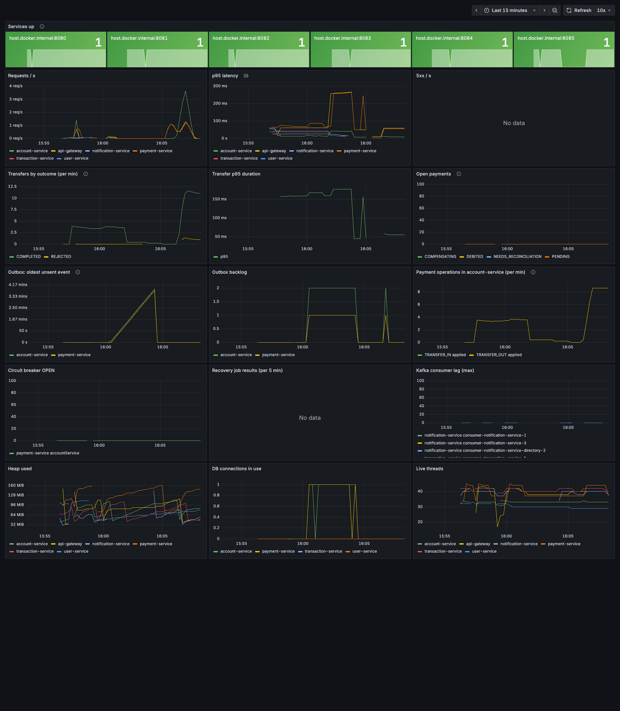

# Phase 14: Monitoring, logging and tracing

## 1. Concepts

Observability answers "what is the system doing, and why?" from the outside, without attaching a debugger. It rests on three signals:

| Signal | Question | Tool here | Shape |
|---|---|---|---|
| **Metrics** | *How much / how fast / how many, over time?* "Is the 5xx rate rising?" | Micrometer → **Prometheus** → **Grafana** | numbers with labels, cheap, aggregated |
| **Traces** | *Where did THIS request spend its time, across services?* | Micrometer Tracing → OpenTelemetry (OTLP) → **Jaeger** | a tree of spans per request |
| **Logs** | *What exactly happened, in words?* | SLF4J/Logback, `[traceId-spanId]` in every line; JSON (ECS) with the `json-logs` profile | events, detailed, expensive at volume |

What ties them together is the **trace ID**: it's in every span, in every log line, and in the `X-Trace-Id` response header the gateway returns. An error on screen shows it, and it leads straight to the trace and the log lines.

### Micrometer Observation: one instrumentation, two signals

```java
Observation.createNotStarted("banking.transfer", registry)
        .lowCardinalityKeyValue("status", "COMPLETED")     // → metric tag AND span tag
        .highCardinalityKeyValue("payment.id", "7755…")     // → span tag ONLY
        .observe(...)
```

This produces a timer `banking_transfer_seconds{status=…}` **and** a span `transfer`. Spring already observes HTTP server/client calls, Kafka send/receive, JDBC pools and the JVM. Only the business-specific parts are written by hand.

### W3C Trace Context

```
traceparent: 00-4d0ebc1f2e6197be52b8bc9dc4bd2ec1-9a4b1c2d3e4f5a6b-01
             ver  trace ID (whole request)        parent span ID   sampled
```

Each hop (HTTP header, Kafka record header) carries it, and the receiver starts a child span of the same trace.

## 2. Why each design decision

| Decision | Why |
|---|---|
| **Micrometer + Prometheus (pull)** | Vendor-neutral API in the code; Prometheus scrapes `/actuator/prometheus` every 15 s. A dead service is detected (`up == 0`) instead of just "going quiet". |
| **OpenTelemetry via the Micrometer bridge, OTLP to Jaeger** | OTLP is the standard wire format: Jaeger today, Tempo / Datadog / Honeycomb tomorrow, by changing one URL. |
| **Trace context stored in the outbox** (`trace_parent` column) | The relay sends from a scheduler thread where no trace exists. Without it, every Kafka event would start a new, disconnected trace. With it, the event continues the trace of the request that caused it (tested, and seen live). |
| **`X-Trace-Id` on every gateway response, shown with errors in the UI** | Support gets one ID that opens the complete call tree. `X-Request-Id` (Phase 6) stays for log searches. |
| **Business metrics on top of the technical ones**: transfers by outcome, payments finished/open, outbox backlog/age, recovery results, applied vs replayed payment operations | Users and money feel these. An alert on "outbox events older than 60 s" says more than CPU graphs. |
| **Tags only with few, fixed values** (status, code, kind, result); IDs only on spans | Every tag combination is a separate time series. A payment ID as a tag would create millions and take Prometheus down ("cardinality explosion"). Tested: no `payment_id` in the metrics. |
| **Gauges read from the database** (open payments, outbox) | Correct across all instances and restarts. An in-memory counter would only know its own instance. |
| **`/actuator/prometheus` open without a token**; everything else under `/actuator` unchanged | Prometheus has no user token. Metrics contain no customer data. The gateway never routes `/actuator`, and in Kubernetes a NetworkPolicy limits access to the monitoring namespace (Phase 16). |
| **Spring Security observations off** (`management.observations.enable.spring.security: false`) | Found live: about 6 security spans per service per request, roughly 60 % of a transfer's trace. |
| **No traces/metrics for `/actuator/**`** (`ObservationPredicate`) | Found live: every scrape and health probe became a trace, burying the real ones, and scrapes distorted the latency panels. |
| **Sampling 100 % locally, configurable** (`TRACING_SAMPLING_PROBABILITY`) | Production traffic is usually sampled at 1–10 %. Metrics stay exact because they're not sampled. |
| **Human-readable logs by default, JSON (ECS) with the `json-logs` profile** | Developers read the console; log collectors (Phase 15/16: Loki, Elasticsearch) parse JSON. Same content: `traceId`, `spanId` and `service.name` in every line. |
| **Alert rules as code, with `for:`** | Rules are reviewed like code. `for:` prevents paging on a 10-second blip. |
| **Everything provisioned** (Grafana data sources and dashboard from files) | A fresh `docker compose up` has the full setup, nothing to click. |
| **Grafana admin password from `.env`** | Never hardcode secrets. Compose refuses to start without it. |

## 3. Architecture

```
                    ┌──────────── traceparent (HTTP header) ───────────┐
 browser ─► gateway ─► payment-service ─► account-service               │
   ▲  X-Trace-Id        │  outbox(trace_parent)   │ outbox(trace_parent)│
   │                    ▼                         ▼                     │
   │                 Kafka ── traceparent (record header) ──► transaction-service, notification-service
   │
   │   every service:  /actuator/prometheus ◄── scrape 15 s ── Prometheus :9090 ── alerts.yml
   │                   spans ── OTLP :4318 ──► Jaeger :16686                 │
   │                   logs: [traceId-spanId] / JSON (ECS)                    ▼
   └── support: trace ID ──────────────────────────────────────────► Grafana :3000 (Prometheus + Jaeger)
```

## 4. Request flow: one transfer, one trace (live, Jaeger)

```
+   0ms api-gateway          http post                                  43ms
+   2ms payment-service      http post /api/payments
+   4ms payment-service      transfer   (banking.transfer observation)   38ms
+   9ms   payment-service    http get   → account-service  GET  /api/accounts/{id}
+  13ms   payment-service    http get   → account-service  GET  /internal/accounts/by-number/{n}
+  20ms   payment-service    http post  → account-service  POST /api/accounts/{id}/withdraw
+  30ms   payment-service    http post  → account-service  POST /internal/accounts/{id}/credit
+ 373ms payment-service      outbox publish → banking.payment-events send
+ 474ms account-service      outbox publish → banking.account-transactions send  (×2)
+ ~1 s  notification-service banking.payment-events receive, banking.account-transactions receive
+ ~1 s  transaction-service  banking.account-transactions receive
```

The gap between 30 ms and 373 ms is the outbox poll interval (500 ms). It's visible in the trace, and it's the price of never losing an event.

## 5. Project structure (new and changed)

```
all 6 services
  pom.xml                     + micrometer-registry-prometheus, micrometer-tracing-bridge-otel,
                                opentelemetry-exporter-otlp (versions from the Spring Boot BOM)
  application.yml             2nd YAML document: Kafka observation, metric tags/histograms, sampling,
                              OTLP endpoint, spring.security observations off; 3rd: profile json-logs
                              exposure + prometheus
  security/SecurityConfig     /actuator/prometheus permitAll
  observability/ObservabilityConfig   NEW  ObservationPredicate: no observations for /actuator/**
  test: PrometheusEndpointTest / ObservabilityIntegrationTest / GatewayObservabilityTest   NEW

account-service, payment-service
  db/migration V3 / V4__outbox_trace_context.sql     NEW  outbox_events.trace_parent
  outbox/OutboxWriter          stores the current traceparent
  outbox/OutboxRelay           sends inside a span restored from it ("outbox publish")
  outbox/OutboxMetrics         NEW  banking_outbox_backlog, banking_outbox_oldest_age_seconds
account-service   AccountService: banking_account_payment_operations_total{kind, result}
payment-service   PaymentService: banking.transfer Observation; PaymentStore: banking_payments_finished_total;
                  PaymentMetrics NEW: banking_payments_open{status}; PaymentRecoveryJob: banking_payments_recovery_total
api-gateway       RequestIdFilter: X-Trace-Id header; CORS exposes it
frontend          ApiError.traceId (from X-Trace-Id), shown in ErrorMessage
infrastructure/monitoring/
  prometheus/prometheus.yml, alerts.yml               scrape config, 8 alert rules
  grafana/provisioning/{datasources,dashboards}       Prometheus + Jaeger data sources, dashboard provider
  grafana/dashboards/banking-platform.json            16 panels
docker-compose.yml   + prometheus v3.5.0, jaeger 2.9.0, grafana 12.1.0
.env.example         + GRAFANA_ADMIN_PASSWORD
```

## 6. Important code

### Configuration (every service, abridged)

```yaml
spring.kafka.template.observation-enabled: true    # span + traceparent header on every record
spring.kafka.listener.observation-enabled: true    # consumer continues the trace
management:
  observations.enable.spring.security: false
  metrics:
    tags.application: ${spring.application.name}
    distribution.percentiles-histogram.http.server.requests: true
  tracing.sampling.probability: ${TRACING_SAMPLING_PROBABILITY:1.0}
  otlp.tracing.endpoint: ${OTLP_TRACING_ENDPOINT:http://localhost:4318/v1/traces}
---
spring.config.activate.on-profile: json-logs
logging.structured.format.console: ecs
```

### Trace context through the outbox

```java
// OutboxWriter: inside the business transaction, inside the request's trace
TraceContext context = tracer.currentTraceContext().context();
propagator.inject(context, carrier, Map::put);           // → carrier.get("traceparent")

// OutboxRelay: later, in a scheduler thread
Span span = propagator.extract(Map.of("traceparent", event.getTraceParent()), Map::get)
        .name("outbox publish").start();
try (Tracer.SpanInScope ignored = tracer.withSpan(span)) {
    return kafkaTemplate.send(topic, key, payload);       // KafkaTemplate's span = child; header injected
} finally {
    span.end();
}
```

### A business observation

```java
Observation observation = Observation.createNotStarted("banking.transfer", observations)
        .contextualName("transfer").start();
try (Observation.Scope ignored = observation.openScope()) {
    TransferResult result = execute(payerId, idempotencyKey, request);
    observation.lowCardinalityKeyValue("status", result.payment().status().name())
               .highCardinalityKeyValue("payment.id", String.valueOf(result.payment().id()));
    return result;
} finally {
    observation.stop();
}
```

### What not to observe

```java
@Bean
ObservationPredicate noActuatorObservations() {
    return (name, context) -> !(context instanceof ServerRequestObservationContext request
            && request.getCarrier().getRequestURI().startsWith("/actuator"));
}
```

### Trace ID for the client (gateway)

```java
withId.getResponse().beforeCommit(() -> {
    ServerRequestObservationContext.findCurrent(withId.getAttributes())
            .map(c -> (TracingContext) c.get(TracingContext.class))
            .map(t -> t.getSpan().context().traceId())
            .ifPresent(id -> withId.getResponse().getHeaders().set("X-Trace-Id", id));
    return Mono.empty();
});
```

## 7. How services communicate (observability flows)

| From → to | What | How |
|---|---|---|
| service → service (HTTP) | trace context | `traceparent` header, added by the observed `RestClient` / gateway `HttpClient` |
| service → Kafka → service | trace context | `traceparent` record header (KafkaTemplate/listener observation); via the outbox's `trace_parent` |
| Prometheus → service | metrics | `GET /actuator/prometheus` (pull, no token) |
| service → Jaeger | spans | OTLP/HTTP `:4318`, batched (≈ every 5 s) |
| Grafana → Prometheus, Jaeger | queries | provisioned data sources |
| gateway → browser | `X-Request-Id`, `X-Trace-Id` | response headers (CORS-exposed) |

### Metric reference (custom)

| Metric | Tags | Meaning |
|---|---|---|
| `banking_transfer_seconds` (histogram) | status, replayed, idempotency_key, error | duration and outcome of `POST /api/payments` |
| `banking_payments_finished_total` | status, code | payments reaching a final status |
| `banking_payments_open` | status | PENDING / DEBITED / COMPENSATING / NEEDS_RECONCILIATION right now |
| `banking_payments_recovery_total` | result = finished, retry_later, exhausted, error | recovery job attempts |
| `banking_outbox_backlog` / `banking_outbox_oldest_age_seconds` | application | unsent events and how long the oldest has waited |
| `banking_account_payment_operations_total` | kind, result = applied, replayed | idempotency at work in account-service |

## 8. Run it

```bash
# once: add GRAFANA_ADMIN_PASSWORD to .env (see .env.example)
docker compose up -d                           # + prometheus :9090, jaeger :16686, grafana :3000
mvn verify                                     # 272 backend tests
mvn -pl <each service> spring-boot:run         # all six
SPRING_PROFILES_ACTIVE=json-logs mvn -pl account-service spring-boot:run   # JSON logs
```

- Grafana: http://localhost:3000 (admin / your password) → Dashboards → Banking → **Banking Platform**
- Jaeger: http://localhost:16686 → service `api-gateway`, or paste an `X-Trace-Id`
- Prometheus: http://localhost:9090/targets, /alerts

From a response to its trace:

```bash
curl -si localhost:8080/api/payments -H "Authorization: Bearer $ALICE" ... | grep -i x-trace-id
curl -s localhost:16686/api/traces/<trace-id> | jq '.data[0].spans | length'
grep <trace-id> logs-of-any-service
```

Request file: [http/phase-14.http](http/phase-14.http).

## 9. Real test results

### Live

| Check | Result |
|---|---|
| Prometheus targets | **6/6 up** (`host.docker.internal:8080–8085`) |
| One transfer through the gateway | 201, `X-Trace-Id: 4d0ebc1f…`; Jaeger: **one trace across all 5 services**: gateway → payment → 4 × account-service → outbox publish → Kafka send → notification- and transaction-service receive |
| Trace size | **56 spans → 18** after switching off Spring Security observations |
| Actuator noise | before: a trace per scrape and probe (every 15 s per service); after the `ObservationPredicate`: **0** |
| Consumers right after a restart | the receive spans came **~20 s** after the send: the restarted consumers were still joining their group, and the events waited in Kafka. In steady state: **< 1 s** end to end. Without the trace this delay would have been invisible. |
| Logs | the same trace ID in payment-service's and account-service's AUDIT lines; with `json-logs`: `{"@timestamp":…,"log":{"level":"INFO","logger":"AUDIT"},"service":{"name":"account-service",…},"traceId":"d115a841…","spanId":"420c015d…",…}` |
| Metrics after traffic | `banking_transfer_seconds_count{status="COMPLETED",replayed="false",…}`, `banking_payments_finished_total{code="none",status="COMPLETED"}`, `banking_account_payment_operations_total{kind="TRANSFER_OUT",result="applied"}`, outbox age 0, consumer lag 0 |
| Alerts: notification-service stopped + Kafka stopped (16:00:14) | `ServiceDown` pending 16:01, **firing 16:02**; `OutboxStalled` (account and payment) pending 16:02, **firing 16:03:49** (60 s age + 2 min `for:`) |
| Restored (16:03:56) | all alerts **resolved by 16:04:37**, both outbox backlogs 0 |
| Grafana | data sources Prometheus and Jaeger healthy; dashboard provisioned (16 panels); anonymous access 401 |



The screenshot shows the session above: the outbox age climbing to ~4 min during the Kafka outage and dropping to 0, the notification-service gap under "Services up", transfers by outcome, and p95 latencies.

### Automated

| Suite | Count | Phase 14 tests |
|---|---|---|
| account-service | 74 (+2) | **ObservabilityIntegrationTest:** a deposit inside a trace → outbox row has its `traceparent` → the Kafka record sent later by the relay carries a `traceparent` of the **same trace**; Prometheus without a token shows outbox gauges and `result="replayed"` after a repeated debit |
| payment-service | 108 (+2) | **ObservabilityIntegrationTest:** all 4 calls to account-service carry `traceparent` of one trace, and the outbox event has it too; Prometheus has `banking_transfer_seconds_count{…status="COMPLETED"}`, histogram buckets, `banking_payments_finished_total`, `banking_payments_open`, outbox and resilience4j metrics, and **no `payment_id`** |
| api-gateway | 29 (+5) | **GatewayObservabilityTest** (real port): `X-Trace-Id` = the trace in the `traceparent` the backend receives; 401s have a trace ID too; `/actuator/health` gets none; Prometheus without a token; other actuator endpoints still protected |
| user / transaction / notification | 34 / 13 / 14 (+2 each) | **PrometheusEndpointTest:** scrapeable without a token, tagged with the service name; `/actuator/metrics` not opened |
| unit tests | | PaymentStoreTest asserts the finished counter; Angular: `ApiError.traceId` from `X-Trace-Id` |
| e2e (Chrome) | 9 | unchanged, passing |

Total: **272 backend** (257 before), 14 Angular unit, 9 e2e.

## 10. Common errors and troubleshooting

| Symptom | Cause / fix |
|---|---|
| `/actuator/prometheus` is 404 | `micrometer-registry-prometheus` missing, or `prometheus` not in `management.endpoints.web.exposure.include`. In tests: metrics export is off unless `@AutoConfigureObservability`. |
| `/actuator/prometheus` is 401 | Not in the security `permitAll` list. |
| Prometheus target DOWN: `connection refused` to `host.docker.internal` | The service isn't running, or (Linux) `extra_hosts: host.docker.internal:host-gateway` is missing. |
| No traces in Jaeger | Wrong `OTLP_TRACING_ENDPOINT` (HTTP needs `/v1/traces`), Jaeger not running (the exporter logs a warning; the app keeps working), or sampling 0. In tests tracing is off unless `@AutoConfigureObservability`. |
| Trace ends at the outbox; consumers start new traces | `trace_parent` not stored or not restored, or `spring.kafka.template.observation-enabled` / `listener.observation-enabled` missing. |
| Traces full of `security filterchain …` spans | `management.observations.enable.spring.security: false`. |
| Every 15 s a new trace `http get /actuator/prometheus` | Exclude `/actuator` with an `ObservationPredicate`. |
| Consumer spans appear seconds after the send | Normal right after a consumer restart (group join/rebalance). In steady state it's < 1 s; if not, check `kafka_consumer_fetch_manager_records_lag_max`. |
| Prometheus very slow / huge memory | High-cardinality tags (IDs, amounts, URLs with IDs). Keep IDs in spans and logs only; URIs use templates (`/api/accounts/{id}`). |
| `histogram_quantile` returns nothing | No buckets: enable `percentiles-histogram` for that metric. |
| Grafana won't start: `set GRAFANA_ADMIN_PASSWORD in .env` | Add it (see `.env.example`). |
| Grafana dashboard blank in a headless-browser screenshot | Found here: a full-page screenshot before layout. Use a normal viewport and wait for the panels (or the `d-solo` URL per panel). |
| Logs have no `[traceId-spanId]` | Tracing disabled (tests), or the code runs outside any observation (e.g. a scheduler without a restored span). |

## 11. Production notes

- **Log aggregation:** with containers (Phase 15) and Kubernetes (Phase 16), the `json-logs` output goes to stdout and is shipped by Grafana Alloy / Fluent Bit to **Loki** or Elasticsearch. Grafana then links log lines ↔ traces by `traceId`.
- **Trace storage:** Jaeger here keeps traces in memory. In production use Grafana Tempo or Jaeger with Elasticsearch/Cassandra, and an **OpenTelemetry Collector** between the services and the backend (batching, tail-based sampling such as "keep every trace with an error", PII scrubbing).
- **Sampling:** head sampling (decided at the gateway) at 1–10 %; tail sampling in the collector to keep all failing or slow traces.
- **Exemplars:** Prometheus can store a trace ID next to a histogram sample, so you can jump from a latency spike straight to an example trace.
- **Alertmanager:** routes alerts (critical → on-call pager, warning → chat), deduplicates and silences them. Every alert should link to a runbook.
- **SLOs:** for example "99.5 % of transfers complete within 2 s over 30 days", with error-budget burn-rate alerts instead of fixed thresholds.
- **Security of telemetry:** no personal data in tags, span attributes or log messages (account numbers and names are in some AUDIT lines here: in production they go to a protected audit store with retention rules). Protect `/actuator/prometheus` by network policy or a separate management port.
- **Kubernetes:** Prometheus Operator `ServiceMonitor`s instead of static targets (Phase 16).

## 12. Interview questions

1. What are the three pillars of observability, and which question does each answer best?
2. Metrics vs logs: why not just count log lines?
3. How does a trace cross from one service to another over HTTP? Over Kafka? What is `traceparent`?
4. Why does a transactional outbox break tracing, and how do you fix it?
5. What is a Micrometer `Observation`, and how is it different from a plain `Timer`?
6. What is metric cardinality? Give an example of a tag that would take Prometheus down.
7. Low- vs high-cardinality key values: where does each end up?
8. Pull (Prometheus) vs push (OTLP metrics, StatsD): trade-offs?
9. Why compute p95/p99 from histograms instead of averages? Why can't you average percentiles across instances?
10. How would you choose a sampling rate? What's tail-based sampling?
11. What makes a good alert? Why `for:`, and why alert on symptoms rather than causes?
12. How do you go from "a customer saw an error" to the root cause, using the tools in this phase?
13. Why should the metrics endpoint not need a user token, and how do you protect it instead?
14. Which observability noise did we remove, and why does it matter?
15. RED and USE methods: which metrics do they ask for, and where are they on this dashboard?
